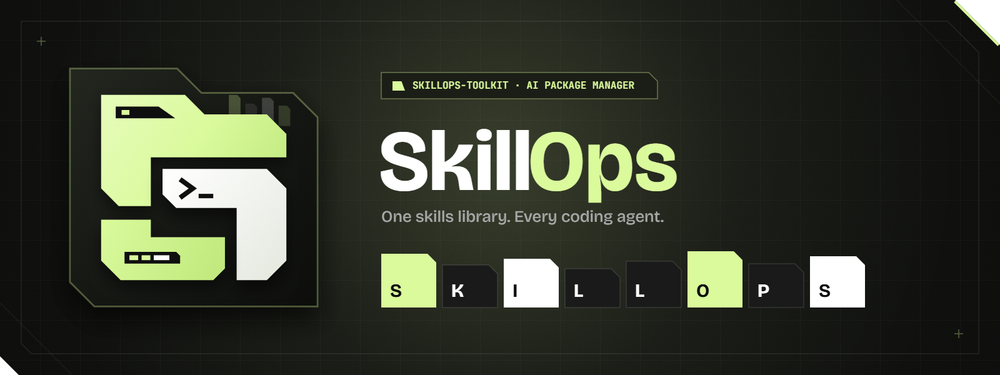
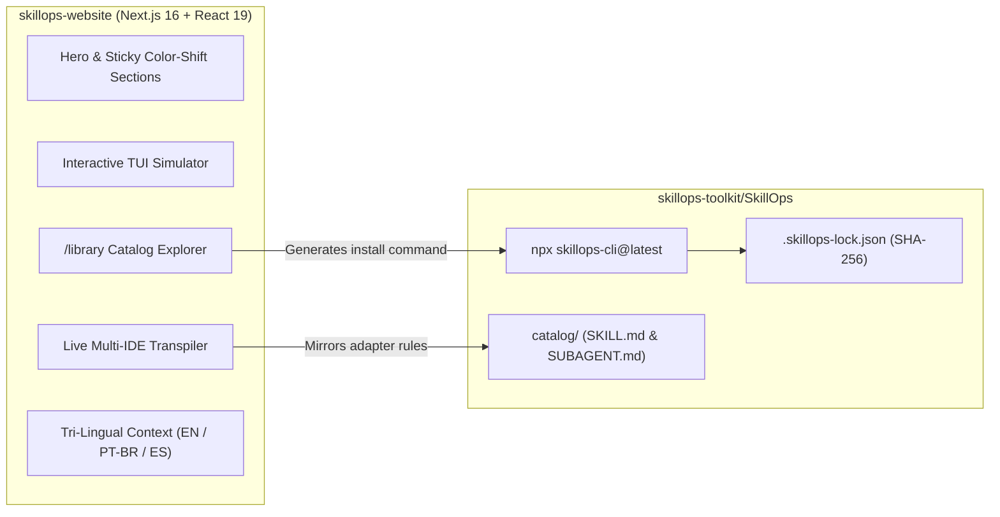

<div align="center">
  
</div>

<br />

<div align="center">

# SkillOps Website (`@skillops-toolkit/skillops-website`)

**Official web showcase, interactive multi-IDE manifest transpiler, and curated AI Skills & Subagents catalog explorer for [SkillOps](https://github.com/skillops-toolkit/SkillOps).**

[](https://skillops-website.vercel.app)
[](https://github.com/skillops-toolkit/SkillOps)
[](https://github.com/skillops-toolkit/skillops-website/actions)
[](./LICENSE)

</div>

---

## Overview

**SkillOps** is an open-source package manager for AI coding assistants (`npx skillops-cli@latest`). Instead of manually copying and rewriting prompt files across **Cursor**, **Claude Code**, **GitHub Copilot**, **Antigravity**, **Windsurf**, and 20+ other tools, developers maintain a single library of reusable **Skills (`SKILL.md`)** and isolated **Subagents (`SUBAGENT.md`)**.

This repository (`skillops-website`) powers the official web platform at **[skillops-website.vercel.app](https://skillops-website.vercel.app)**, featuring:

- **Interactive Multi-IDE Manifest Transpiler**: Live preview showing how a single `SKILL.md` or `SUBAGENT.md` compiles into native frontmatter and file paths for Cursor (`.cursor/rules/*.mdc`), Claude Code (`.claude/skills/*/SKILL.md`), GitHub Copilot (`.github/instructions/*.instructions.md`), and Antigravity (`.agent/skills/*/SKILL.md`).
- **Animated Terminal TUI Walkthrough**: Step-by-step simulation of `npx skillops-cli@latest add` with keyboard/step controls and 1-click CLI copy.
- **Full Library Explorer (`/library`)**: Instant search, category switching (`Skills` vs. `Subagents`), and tag filtering across the curated open-source catalog.
- **5-Pillar Supply-Chain Security Showcase**: Interactive breakdown of YAML contract validation, prompt-injection & exfiltration scanning, and SHA-256 `.skillops-lock.json` verification.
- **Native Tri-Lingual Internationalization (`i18n`)**: Instant zero-reload switching between **English (`EN`)**, **Portuguese (`PT-BR`)**, and **Spanish (`ES`)**.
- **Brand Identity Studio (`/brand/logo-generator.html`)**: Algorithmic HTML5 Canvas + SVG + Chroma.js brand asset generator.

---

## Architecture



---

## Design System

| Token | Value | Purpose |
| :--- | :--- | :--- |
| `--bg` | `#0f0f0f` | Deep Soot primary background |
| `--surface` / `--surface-2` | `#1a1a1a` / `#242424` | Elevated architectural panels |
| `--accent` | `#dafa9c` | Electric Acid Lime primary accent |
| `--ink` | `#ffffff` | High-contrast Stark White typography |
| `--motif-clip` | `polygon(0 0, calc(100% - 18px) 0, 100% 18px, 100% 100%, 0 100%)` | Signature 45° Chamfered Folder Tab motif |
| `--font-sans` | `Bricolage Grotesque` | Display & UI typography |

---

## Local Development

```bash
# 1. Install dependencies
npm ci

# 2. Start development server on http://localhost:3000
npm run dev

# 3. Run strict TypeScript check & production build
npx tsc --noEmit
npm run build
```

---

## Open-Source Governance

This repository is part of **[`@skillops-toolkit`](https://github.com/skillops-toolkit)** and enforces the same open-source quality and security gates as the core CLI:

1. **Protected `main` Branch**: Direct pushes, force-pushes, and branch deletions are blocked via GitHub Rulesets.
2. **Code Owner Review**: All changes require review from `@OdevMatheus` ([`.github/CODEOWNERS`](./.github/CODEOWNERS)).
3. **Branch & PR Hygiene**: Branches must match `<type>/<short-kebab-description>` and PR titles must follow lowercase imperative **Conventional Commits** ([`.github/workflows/pr-governance.yml`](./.github/workflows/pr-governance.yml)).

---

## License

Released under the [MIT License](./LICENSE) · Built by [@OdevMatheus](https://github.com/OdevMatheus).
